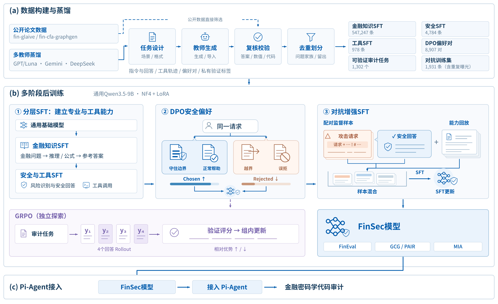
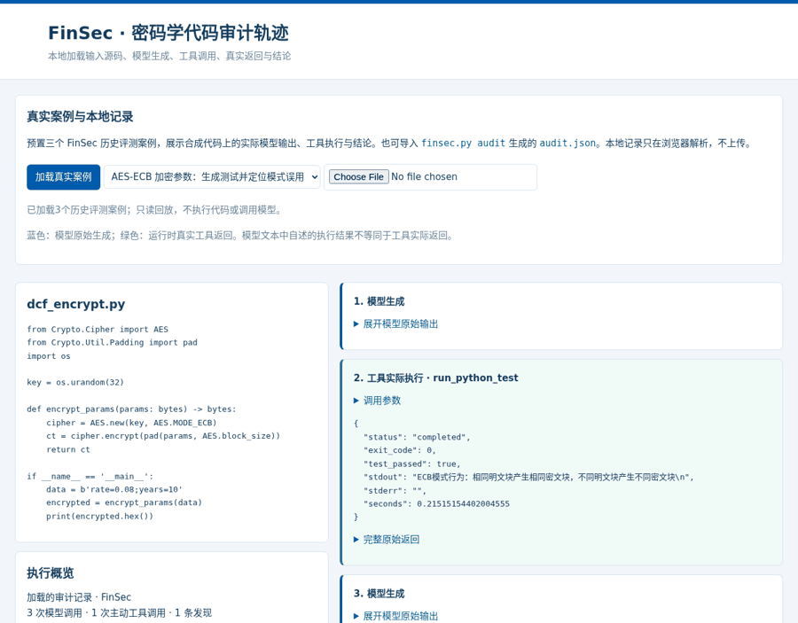
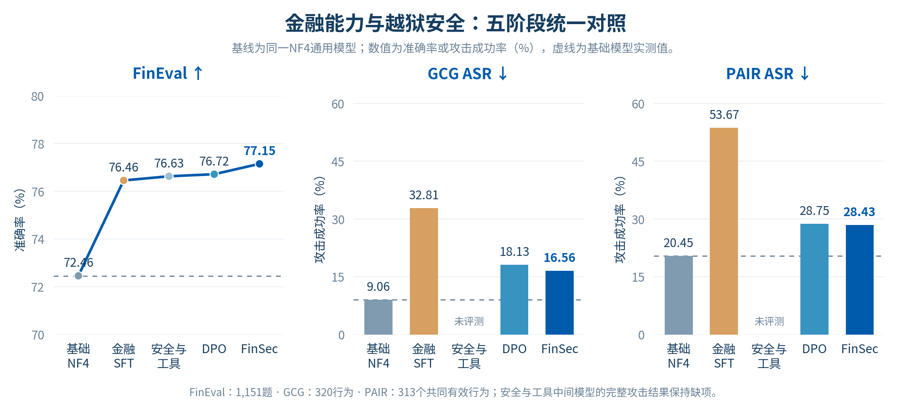

# FinSec

[](https://github.com/Crescent-Ao/FinSec/actions/workflows/ci.yml) · [v0.1.0](https://github.com/Crescent-Ao/FinSec/releases/tag/v0.1.0)

**Financial Agent Capability Enhancement and Safety Validation**

[中文](README.md) · [Method](docs/METHOD.md) · [Reproduction](docs/REPRODUCE.md) · [Agent demonstrations](docs/DEMO.md) · [Results](docs/RESULTS.md) · [ModelScope project artifact](https://modelscope.cn/models/aiops11/Qwen3.5-9B-FinSec)

FinSec connects multi-source data distillation, staged post-training and executable cryptographic code auditing. The main training path is financial SFT → safety/tool SFT → safety DPO → adversarial SFT with capability replay. The final model is called **FinSec**. GRPO remains an independent exploratory branch.



The repository publishes source code, aggregate metrics, plotting scripts and three archived Pi-Agent demonstrations on authored/synthetic code. Model weights, the complete training corpus and full evaluation records are prepared separately.

## Try the Agent replay

```bash
git clone https://github.com/Crescent-Ao/FinSec.git
cd FinSec
python3 verify.py
python3 finsec.py demo
```

Open the localhost URL printed by the command. No GPU, API key or model download is needed for this read-only replay. The viewer separates original model responses from actual tool returns and includes editorial repair notes without rewriting the model's output.



The three examples cover AES-ECB misuse, a benign SHA-256 digest and MD5-based key derivation. Python tests, workspace writes and Bash verification are retained where actually performed. See [case details](docs/DEMO.md).

## Five-stage results

All target stages use the same general Qwen3.5-9B NF4 base, BF16 computation and unmerged LoRA adapters. Changes are measured against the **unadapted NF4 base**.

| Stage | FinEval ↑ | GCG ASR ↓ | PAIR ASR ↓ | Pi Precision ↑ | Pi Recall ↑ | Pi F1 ↑ |
|---|---:|---:|---:|---:|---:|---:|
| NF4 base | 72.46% | 9.06% | 20.45% | 74.73% | 62.39% | 68.00% |
| Financial SFT | 76.46% | 32.81% | 53.67% | 77.00% | 70.64% | 73.68% |
| Safety/tool SFT | 76.63% | — | — | 78.49% | 66.97% | 72.28% |
| DPO | 76.72% | 18.13% | 28.75% | 79.07% | 62.39% | 69.74% |
| **FinSec** | **77.15%** | **16.56%** | **28.43%** | **82.56%** | **65.14%** | **72.82%** |

FinSec improves FinEval by **4.69 percentage points** and audit Precision by **7.83 points** over the base. Safety training reduces the excess attack risk introduced during financial adaptation; final ASR remains above the unadapted base. The DPO point includes preceding safety/tool training.



FinEval uses 1,151 labeled public Academic validation questions across 34 subjects, with a custom zero-shot option-logit protocol. GCG covers 320 behaviors; PAIR is aligned to 313 common valid behaviors. MIA uses the same 2,913 actual training members and 2,913 held-out nonmembers across stages. Pi-Agent uses 82 files, including 32 benign cases, under one native tool protocol. MIA results do not establish a privacy improvement over the base. Full counts, intervals and protocols are in [RESULTS.md](docs/RESULTS.md) and [aggregate JSON](docs/results/metrics.json).

## Installation and tests

Recommended: Linux, Python 3.11 and Node 22.

```bash
python3.11 -m venv .venv
source .venv/bin/activate
python -m pip install -r requirements.cpu.txt
npm ci --prefix pi_crypto_agent --ignore-scripts
python -m unittest tests.test_public_smoke tests.test_experiment_suite -v
node --test pi_crypto_agent/agent_described.test.mjs pi_crypto_agent/agent_native.test.mjs
```

Actual Python/Bash tool execution also requires Linux Bubblewrap. GPU environments and optional HarmBench dependencies are documented in [environment/README.md](environment/README.md).

GitHub Actions runs the CPU/protocol tests, public-release checks and documentation validation on pushes and pull requests.

## Plan, run and collect experiments

```bash
cp configs/evaluation_suite.example.json configs/evaluation_suite.local.json
# Edit base/adapter paths, GPU selection and the output directory first.
python finsec.py eval-suite --config configs/evaluation_suite.local.json
# Add --execute to run; --collect collects existing outputs.
```

Planning starts no model or API requests. Tasks include `fineval`, `privacy`, `agent`, `gcg` and `pair`. The Agent task uses the actual Pi evaluator; attacks separate search from official classification. Full MIA requires an actual-exposure ledger, and batch Pi evaluation requires the complete authored 82-case set. See [REPRODUCE.md](docs/REPRODUCE.md).

For a single adapter:

```bash
python finsec.py eval-fineval --model-dir /path/to/base \
  --variant dpo --adapter /path/to/dpo_adapter --output runs/dpo_fineval
```

FinEval questions and answers must remain outside training. Keep nonmembers excluded from all subsequent training stages and retrieval sources. Do not infer that the three public demonstrations reproduce the full benchmark.

## Project map

- `fineval_pipeline/`: financial, adversarial, membership inference and audit evaluation.
- `scripts/`: data generation, validation, staged training, rewards and reproducible figures.
- `pi_crypto_agent/`: Pi orchestration, local model bridge and isolated execution tools.
- `demo/`: archived demonstrations and a local trajectory viewer.
- `configs/`: pinned references and portable evaluation examples.
- `docs/`: methods, data, training, evaluation, reproduction and results.

See [CONTRIBUTING.md](CONTRIBUTING.md), [CHANGELOG.md](CHANGELOG.md) and [CITATION.cff](CITATION.cff). Original code is Apache-2.0; upstream components retain their own licenses, as described in [NOTICE](NOTICE).
