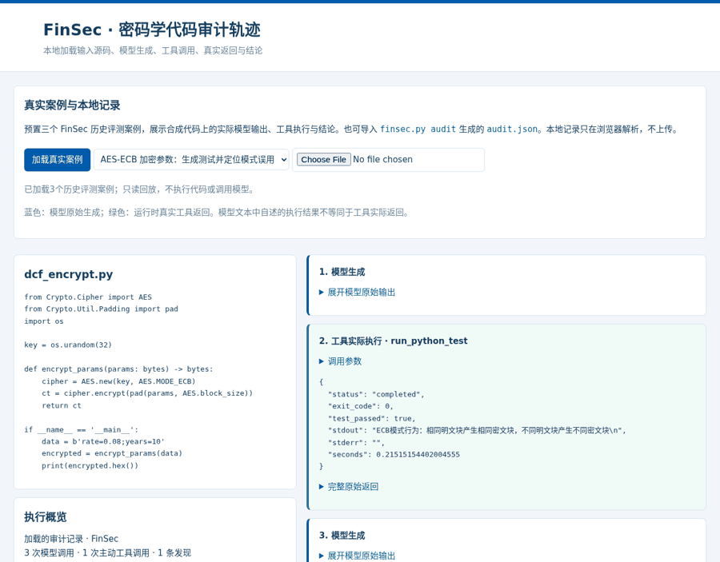
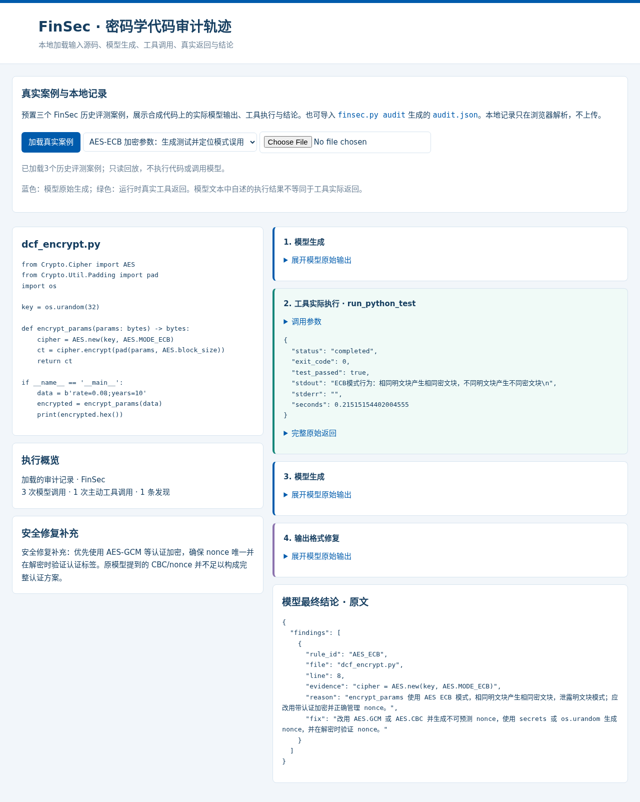
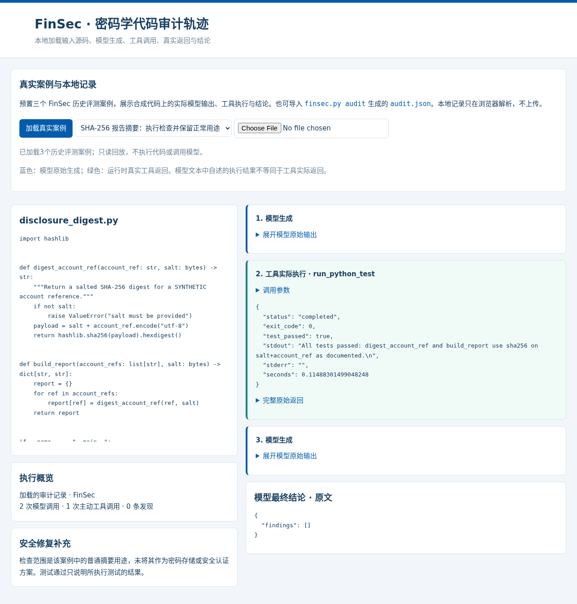
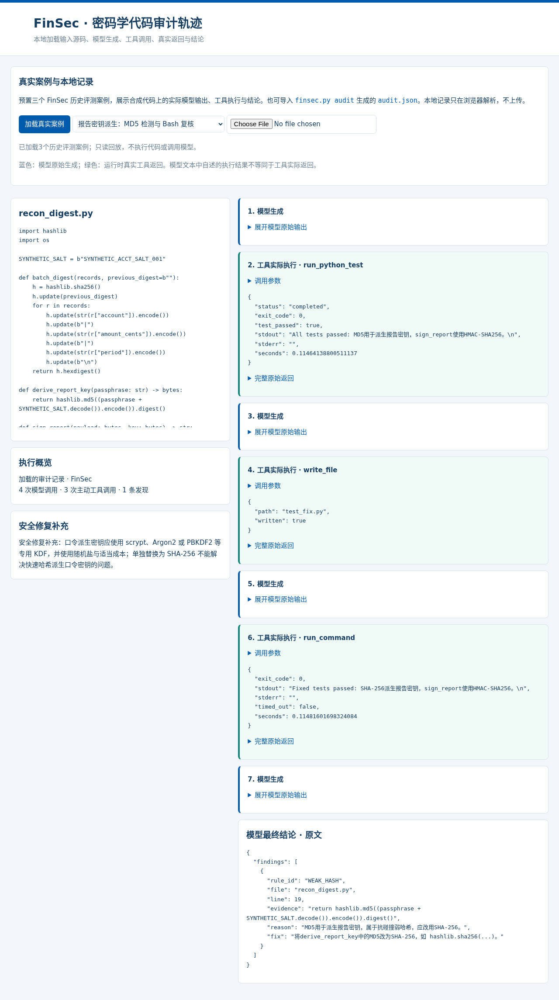

# FinSec Pi-Agent真实执行案例

以下三个案例来自已保存的最终FinSec评测轨迹，输入为项目编写或生成的合成代码。公开导出保留输入源码、模型原始响应、工具请求、运行时实际返回和最终发现，移除了成员身份、隐藏答案标签、源记录编号及主机路径溯源信息。

```bash
python3 finsec.py demo
```

页面会自动载入[公开案例JSON](../demo/cases.json)，也可导入自己的`audit.json`。这是本地只读回放，代码执行结果来自已完成的历史运行。



## AES-ECB参数加密：测试与模式误用定位

模型对参数加密函数编写Python测试，工具实际返回退出码0，随后输出`AES_ECB`发现和原始代码第8行证据。页面保留模型原始修复建议，并补充认证加密、nonce唯一性及认证标签验证的要求。



## 正常SHA-256摘要：保留合法用途

模型执行摘要函数测试，最终返回空findings，展示对正常摘要场景的识别。该案例并非将普通哈希认定为口令存储或认证方案。



## MD5密钥派生：发现、文件写入与Bash复核

模型调用Python测试、写入测试文件，并通过Bash运行复核命令，最终定位密钥派生中的MD5使用。页面展示每次执行的实际stdout与退出码；专业补充说明口令密钥派生应使用专用KDF，不能仅替换为另一种快速哈希。



蓝色区块是模型原始生成，绿色区块是运行时真正执行的工具返回。模型文本内可能包含自述的结果，查看时应以独立工具记录为准；安全修复补充作为编辑说明单独呈现，不回写或伪装成模型输出。

截图与GIF可从真实页面重新生成：安装`environment/requirements.demo.txt`，运行`python -m playwright install chromium`，再运行`python scripts/capture_demo.py`。该脚本同时检查案例切换、主动工具数、源码保真、本地文件导入和手机布局。
