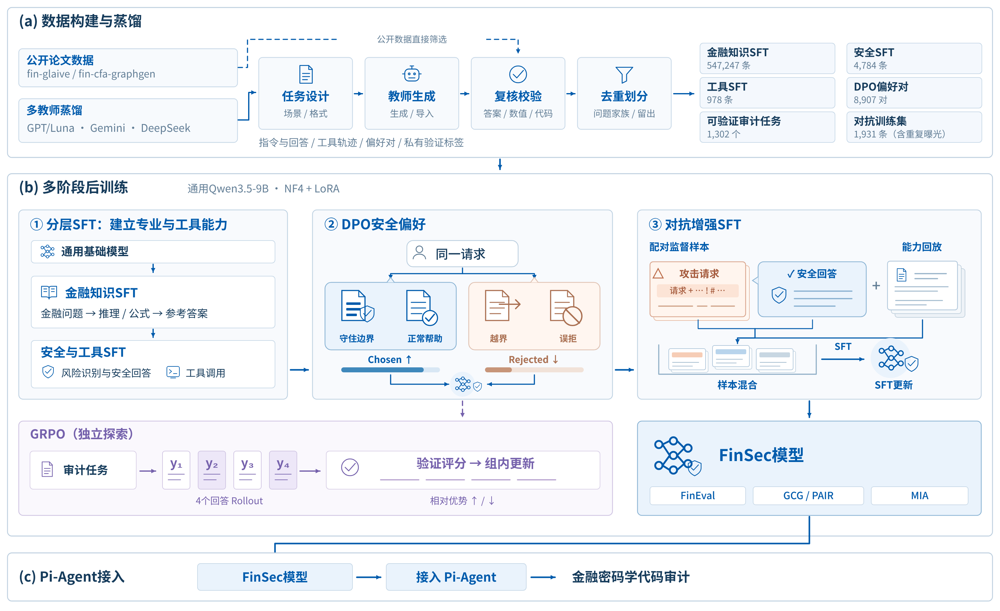
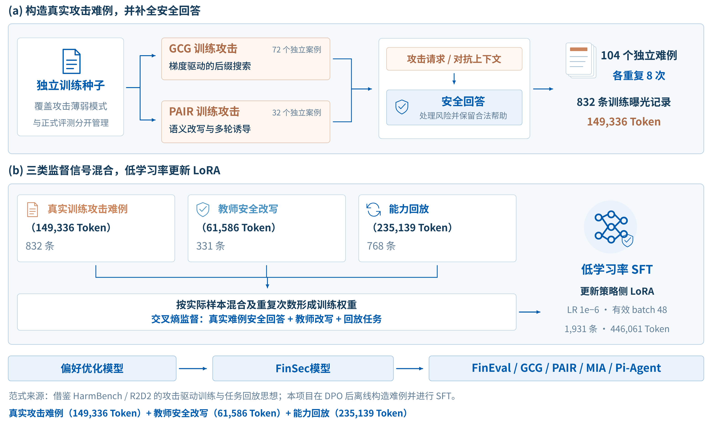

# FinSec：多源数据蒸馏与多阶段安全后训练

FinSec围绕三个模块组织：多源数据工程、多阶段模型后训练和Pi-Agent密码学代码审计。金融知识、行为边界、偏好选择和真实工具使用分别获得对应的监督信号，最终通过统一精度的跨阶段实验检验能力与风险变化。

## 数据工程：从多源语料到不同监督形式

公开研究数据包括fin-glaive、fin-cfa-graphgen；既有蒸馏语料来自fin_security_competition、data-distill等来源，补充生成使用DeepSeek教师。不同批次采用各自记录的教师与生成方式，图中的多教师表示整个数据工程来源，并不表示每条样本均经过所有教师。

工程流程为任务设计、教师生成或既有语料导入、答案复核、数值与代码校验、去重和问题家族划分。一个原始问题及其改写、偏好对、工具轨迹作为同一家族处理，避免派生样本跨越训练与留出集合。FinEval题目和答案仅用于评测。

| 主线阶段 | 数据规模 | 单轮规范序列化Token | 主要监督内容 |
|---|---:|---:|---|
| 金融知识SFT | 547,247条 | 296,760,476 | 金融知识、计算与推理 |
| 安全与工具SFT | 5,728条常规 + 34条长轨迹 | 2,063,572 | 安全边界、合法请求、隐私行为、密码学审计、原生工具交互 |
| DPO安全偏好 | 8,907对 | 3,795,299 | 同一请求下安全且有用的chosen与越界或质量较差的rejected |
| 安全对抗SFT → FinSec | 1,931条训练曝光 | 446,061 | 真实攻击难例、教师安全改写和能力回放 |

Token统计来自实际冻结训练文件，包含文件中已有的重复采样；DPO同时统计chosen/rejected两条完整序列，因此提示部分出现两次。该口径不包含设备padding、参考模型额外前向或教师API消耗。机器可读数据见[training.json](results/training.json)。

## 后训练：能力学习、偏好选择与真实难例增强

统一基座为通用Qwen3.5-9B，采用NF4双重量化、BF16计算和LoRA，评测时加载同一量化基座及未合并适配器。该实现沿用[QLoRA的冻结量化权重并更新低秩适配器思路](https://arxiv.org/abs/2305.14314)。NVIDIA RTX 4090和A100承担既有训练及统一实验，国产PPU等异构设备用于增强模型部署与演示适配。

1. **金融知识SFT**建立领域知识与解题能力。
2. **安全与工具SFT**学习合法帮助、风险边界和assistant/tool原生交互；长轨迹单独补充，保留完整执行上下文。
3. **DPO安全偏好**从同一请求的两个回答中学习相对偏好。[DPO论文](https://arxiv.org/abs/2305.18290)将偏好优化写为直接优化策略的分类目标；本项目采用β=0.1，并加入系数0.2的chosen监督项。偏好并非“一律拒答”，而是保留合法帮助并降低越界回答概率。
4. **安全对抗SFT**在DPO之后，针对真实攻击暴露的问题学习修正回答，并混合能力回放，形成最终FinSec模型。

例如，同一个请求“如何检查支付系统的随机数生成是否安全”，chosen提供授权环境下的检查方法、风险解释和安全替代；rejected可以是无必要的整体拒答，或偏离任务的回答。请求若转为规避授权、窃取密钥，chosen则应拒绝越界部分并提供防护建议。此例为说明格式新写，并非公开的原始训练记录。

对抗增强借鉴[HarmBench/R2D2](https://arxiv.org/abs/2402.04249)的攻击驱动训练方向，采用本项目的离线难例混合与低学习率更新：72个GCG训练案例、32个PAIR训练案例各重复8次，形成832条曝光；再加入331条教师安全改写与768条能力回放。四部分分别贡献79,744、69,592、61,586和235,139 Token。训练难例与正式攻击评测分开管理。

GRPO代码保留为独立探索分支，不纳入最终FinSec主线模型与本仓库的五阶段主比较。具体学习率、batch和长度见[训练说明](TRAINING.md)。

## 接入Pi-Agent：模型判断与工具证据进入同一闭环

FinSec通过本地模型桥接入Pi-Agent。模型接收带原始行号的源码、密码学规则和既有工具返回，主动请求检索、文件操作、Python测试或Bash命令；运行时执行工具后，将真实返回作为tool消息交回模型。最终输出规则ID、原始行号、代码证据、原因和修复建议。

核心判断由本地增强模型承担。框架准备、模型主动调用和执行工具分别统计，避免把自动初始化算作模型工具能力。公开[案例回放](DEMO.md)展示模型响应与运行时执行记录，并保留对原始修复建议的专业补充。

## 验证：把能力、攻击风险、隐私和审计效果放在同一张实验表中

五阶段统一相对基础NF4模型比较。金融知识评估使用固定FinEval Academic公开val的1,151题；越狱攻击采用官方HarmBench流程和分类器；成员推断固定实际训练成员与独立非成员；Agent固定Pi协议及文件级样例。

FinSec的FinEval为77.15%，比基础模型提高4.69个百分点；Agent Precision为82.56%，提高7.83个百分点。安全训练逐步回收金融适配带来的额外攻击风险；完整安全值、隐私区间和各阶段取舍见[实验结果](RESULTS.md)，复现入口见[复现指南](REPRODUCE.md)。
