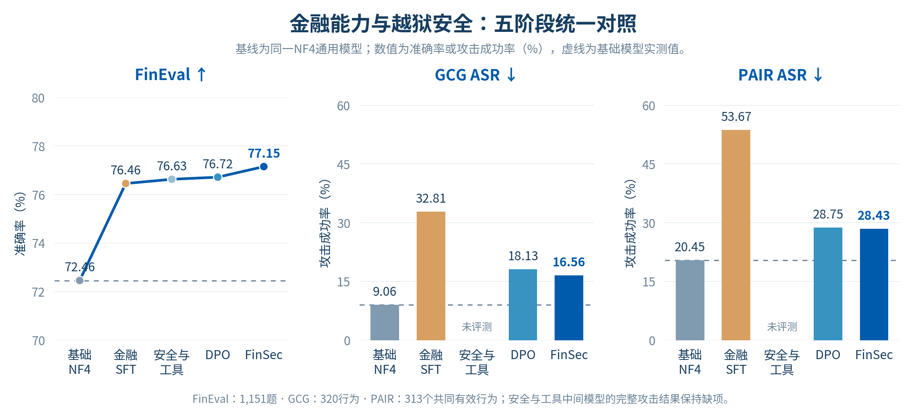
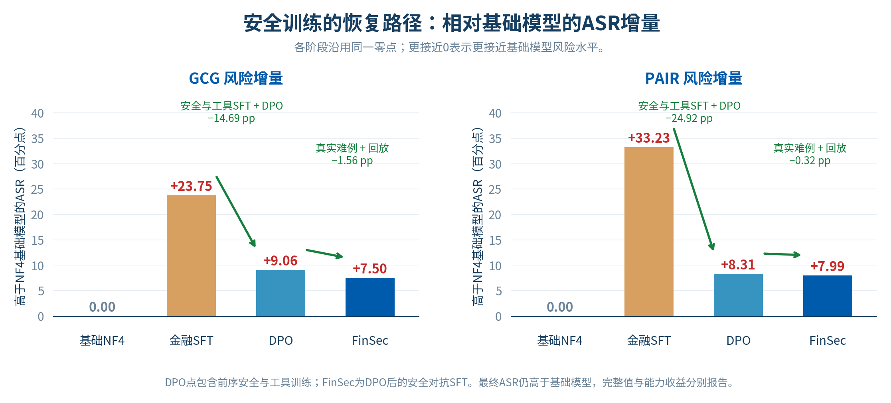
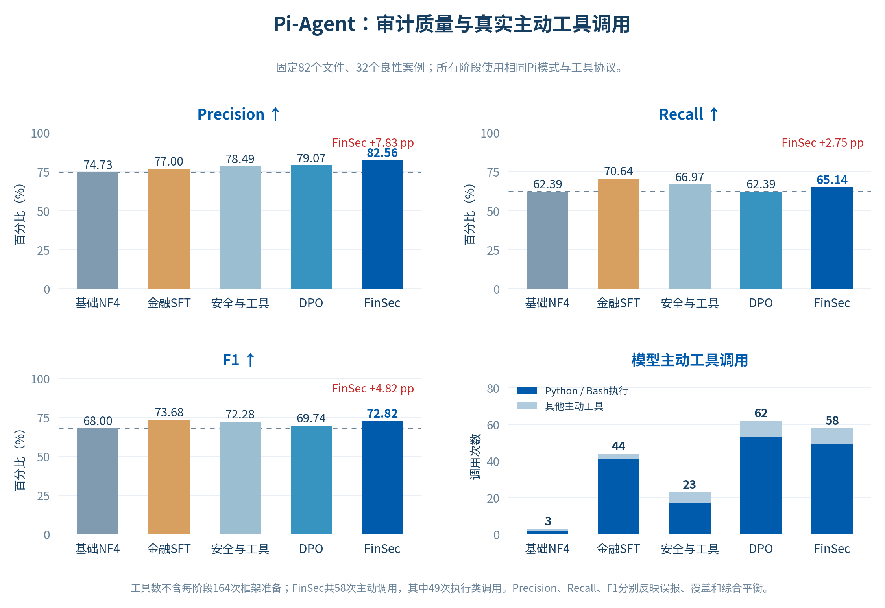
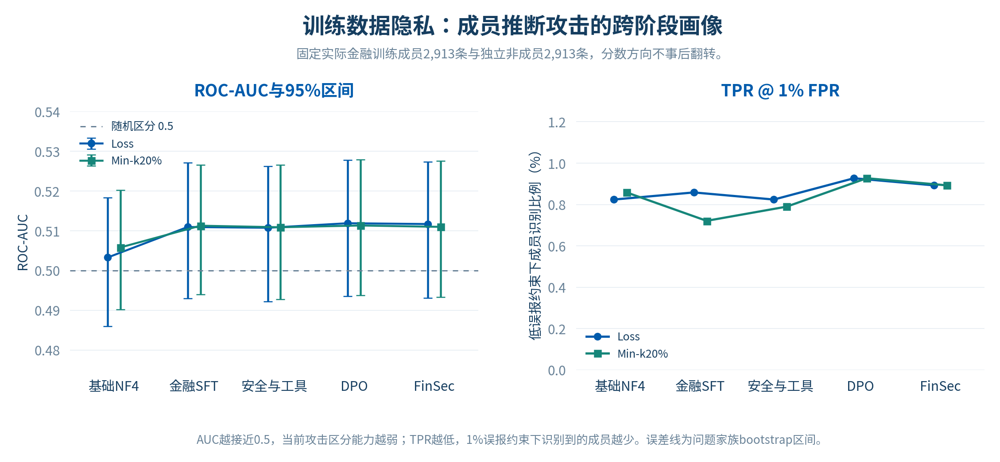

# 多阶段实验结果与评测口径

数据日期：2026年11月10日。基线为通用Qwen3.5-9B以NF4双重量化、BF16计算加载，不附加项目LoRA。最终FinSec是DPO后继续安全对抗SFT得到的模型。

## 1. 金融能力、安全与审计质量

| 模型阶段 | FinEval ↑ | GCG ASR ↓ | PAIR ASR ↓ | 审计Precision ↑ | 审计Recall ↑ | 审计F1 ↑ |
|---|---:|---:|---:|---:|---:|---:|
| 基础模型 | 72.46% | 9.06% | 20.45% | 74.73% | 62.39% | 68.00% |
| 金融模型 | 76.46% | 32.81% | 53.67% | 77.00% | 70.64% | 73.68% |
| 安全与工具模型 | 76.63% | — | — | 78.49% | 66.97% | 72.28% |
| 偏好优化模型 | 76.72% | 18.13% | 28.75% | 79.07% | 62.39% | 69.74% |
| **FinSec模型** | **77.15%** | **16.56%** | **28.43%** | **82.56%** | **65.14%** | **72.82%** |



FinSec相对基础模型的FinEval增益为+4.69个百分点，审计Precision、Recall、F1分别为+7.83、+2.75、+4.82个百分点。不同指标反映不同取舍，表格保留全部阶段的实际值。

## 2. 安全恢复路径



DPO点包含前序安全与工具SFT；其后真实GCG/PAIR训练难例、教师安全改写和能力回放共同构成FinSec增强。金融适配到DPO阶段，GCG与PAIR ASR分别下降14.69和24.92个百分点；FinSec进一步下降1.56和0.32个百分点。图中柱高始终相对同一基础模型计算：最终额外风险收敛至7.50和7.99个百分点，同时金融能力保持增长。

## 3. Pi-Agent



固定82个文件，其中32个良性文件。规则ID与原始行号匹配后计算TP/FP/FN及Precision、Recall、F1；格式失败保留在评测中。工具调用只统计模型主动请求，每模型164次框架准备单独处理。所有阶段使用同一Pi工具协议、12次模型调用上限、4096输出Token上限和16384上下文。

## 4. 成员推断

| 模型阶段 | Loss AUC | Loss TPR@1%FPR | Min-k AUC | Min-k TPR@1%FPR |
|---|---:|---:|---:|---:|
| 基础模型 | 0.503265 | 0.8239% | 0.505808 | 0.8582% |
| 金融模型 | 0.510941 | 0.8582% | 0.511263 | 0.7209% |
| 安全与工具模型 | 0.510739 | 0.8239% | 0.510873 | 0.7896% |
| 偏好优化模型 | 0.511887 | 0.9269% | 0.511312 | 0.9269% |
| FinSec模型 | 0.511682 | 0.8926% | 0.510972 | 0.8926% |



所有阶段使用相同实际训练成员2,913条及独立非成员2,913条，方向固定为高分更像成员。Min-k比例为20%；低误报工作点不插值。图中误差线为问题家族bootstrap 95%区间。参考模型差异攻击及各工作点的实际FPR也在聚合JSON中保存。

当前结果形成一致的跨阶段隐私风险画像，并未显示相对基础模型的隐私风险下降。

## 5. 固定协议

| 项目 | 口径 |
|---|---|
| FinEval | 固定HF Academic完整公开val，34科、1,151题；原生非thinking模板、零样本选项logits；非官方test成绩 |
| GCG | 官方实现，320行为；本项目预算50搜索步、宽度128、目标回答最多512新Token |
| PAIR | 官方流程；四模型共同313个有效BehaviorID，单独攻击各目标模型 |
| HarmBench评分 | 相同官方HarmBench-Llama-2-13b-cls及版权规则 |
| MIA | 实际第一阶段金融训练成员与留出非成员；Loss、Min-k及参考模型差异；相同序列化与答案区间 |
| Agent | 固定82文件、32良性；同一Pi原生工具协议，核心判断由本地模型承担 |

安全与工具中间阶段没有同协议完整GCG/PAIR结果，表内保持“—”，不记为0。PAIR历史314行为的结果先对齐共同313个行为再进入本表。所有主结果变化均相对NF4基础模型；第一阶段金融保留门槛另行计算。

## 6. 复现图表

```bash
python -m pip install -r environment/requirements.figures.txt
python scripts/plot_results.py
python scripts/update_results_docs.py
```

中文字体优先使用Noto Sans CJK，也支持Microsoft YaHei/SimHei。PNG用于GitHub直接展示，SVG使用字形轮廓保证跨设备显示。数据源为 [metrics.json](results/metrics.json)，仅含聚合统计、分母、协议与区间，不含训练文本、成员ID或逐样本回答。

已有完整实验包时，可用 `python3 verify.py --bundle-root /path/to/FinSec_1123`重算逐样本结果；这与本页聚合结果绘图分别管理。
